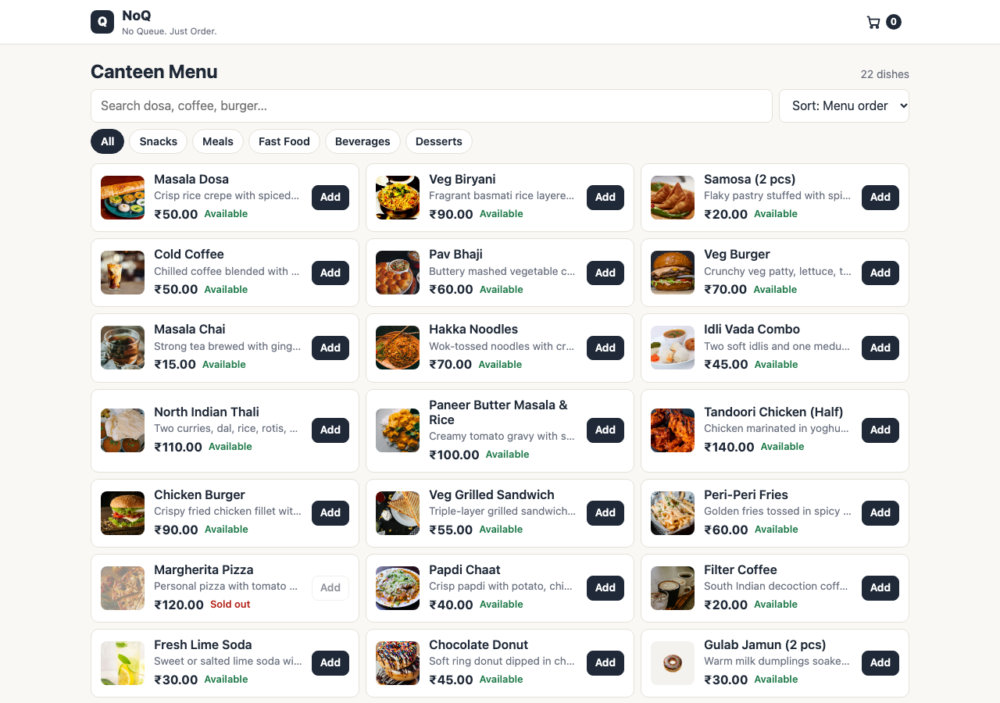
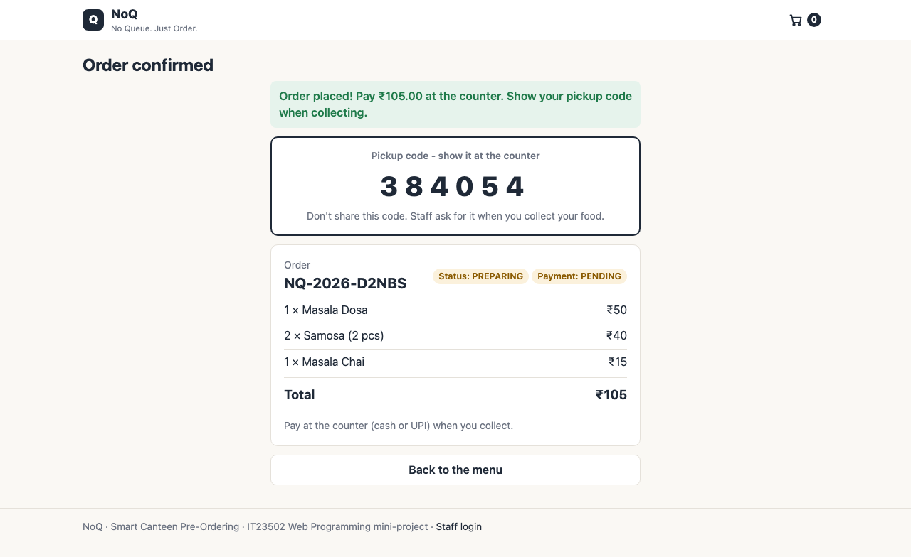
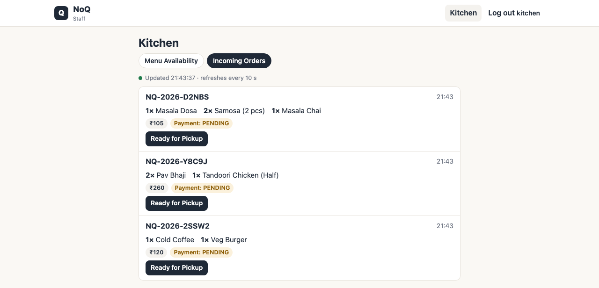
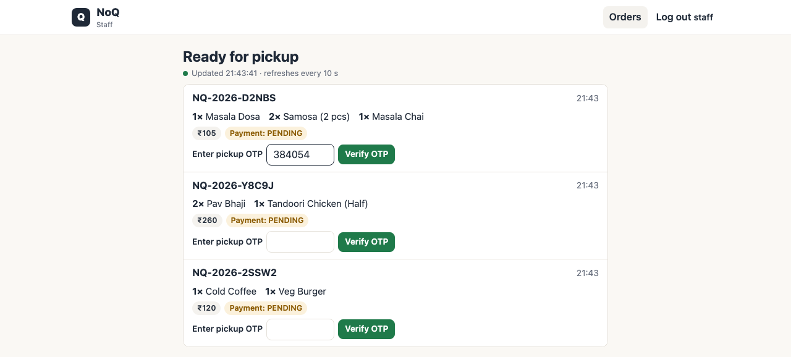

# NoQ — Smart Canteen Pre-Ordering & Queue Management

> **No Queue. Just Order.** Students browse the live canteen menu, pre-order, get an order reference and a
> 6-digit pickup OTP, and collect (and pay for) their food at the counter
> when it's ready. The kitchen marks dishes available and orders ready; counter staff check the pickup code and hand the food over.

College mini-project for **IT23502 — Web Programming** (Unit IV: Advanced Frameworks, Unit V: Web Services).

| | |
|---|---|
| Main application | `noq-app` — Spring Boot 3.5 MVC + Thymeleaf + REST + JPA/Hibernate + MySQL · **port 8080** |
| Microservice | `noq-notification-service` — tiny independent Spring Boot REST service · **port 8081** |
| Build | Maven multi-module (one Git repo, two independent apps) · Java 21 |

## Documentation

| Document | What's inside |
|---|---|
| [docs/ARCHITECTURE.md](docs/ARCHITECTURE.md) | Directory structure, architecture diagram, ER diagram, request-flow and state diagrams (Mermaid) |
| [docs/API.md](docs/API.md) | Every endpoint with sample requests and real success/failure responses |
| [docs/REPORT.md](docs/REPORT.md) | Project report for college submission |
| [docs/REQUIREMENTS_MAP.md](docs/REQUIREMENTS_MAP.md) | Every assignment requirement → class / file / endpoint / test, plus the screenshot checklist |
| [docs/VIVA_GUIDE.md](docs/VIVA_GUIDE.md) | Viva questions and answers for all Unit IV and Unit V concepts |
| [docs/CODE_WALKTHROUGH.md](docs/CODE_WALKTHROUGH.md) | Every important class explained, and the life of one order step by step |
| [docs/schema-mysql.sql](docs/schema-mysql.sql) | MySQL DDL matching the entities (see the note at the top of the file) |
| [docs/screenshots/](docs/screenshots/) | 14 real screenshots of the running app (customer, Kitchen, Staff, desktop and phone); the list is in REQUIREMENTS_MAP |
| [docs/diagrams/](docs/diagrams/) | Static diagrams (architecture, request flow, workflows, order life-cycle, ER, notification sequence) |
| [docs/TeamNo_NoQ_Report.docx](docs/TeamNo_NoQ_Report.docx) | The Word version of the project report for submission |
| [postman/NoQ.postman_collection.json](postman/NoQ.postman_collection.json) | 35 Postman requests with automatic tests |

---

## 1. Prerequisites

| Tool | Version | Check |
|---|---|---|
| JDK | 21 or newer | `java -version` |
| MySQL Server | 8.x | `mysql --version` |
| Maven | not needed — use the included wrapper `./mvnw` (downloads Maven 3.9 on first run) | |
| Git | any | `git --version` |
| Postman | any (optional) | |
| Spring Tool Suite 4 / Eclipse / IntelliJ | optional | |

## 2. Configure the database

1. Start MySQL and make sure you know a username/password that can create databases.
2. Copy the configuration template and fill in **your own** password (the real `.env` is git-ignored):

   ```bash
   cp noq-app/.env.example noq-app/.env
   ```

   ```properties
   DB_URL=jdbc:mysql://localhost:3306/noq_db?createDatabaseIfNotExist=true
   DB_USERNAME=root
   DB_PASSWORD=your-mysql-password
   NOTIFICATION_URL=http://localhost:8081
   ```

   You can also set these as real environment variables instead of using `.env`.

That's all: on start-up Hibernate creates the tables from the `@Entity` classes (`ddl-auto=update`) and
`data.sql` loads 23 sample menu items and two staff accounts. Restarting never duplicates or overwrites data
(`INSERT IGNORE`).

> **No MySQL handy?** Run with the in-memory `h2` profile (MySQL compatibility mode). Everything works,
> but data is lost when the app stops:
> `./mvnw -pl noq-app spring-boot:run -Dspring-boot.run.profiles=h2`

## 3. Run both applications

Open two terminals in the project root.

```bash
./mvnw -pl noq-notification-service spring-boot:run
```

```bash
./mvnw -pl noq-app spring-boot:run
```

(On Windows use `mvnw.cmd` instead of `./mvnw`.)

| URL | What |
|---|---|
| http://localhost:8080/ | Customer menu |
| http://localhost:8080/cart | Cart, checkout and order confirmation (pickup code) |
| http://localhost:8080/staff | Login; then the Staff page (ready orders) for `staff`, or the Kitchen page for `kitchen` |
| http://localhost:8080/staff/kitchen | Kitchen: Menu Availability and Incoming Orders tabs |
| http://localhost:8080/actuator/health | Health check |
| http://localhost:8081/api/notifications | Notifications received by the microservice |

**Demo staff accounts** (seeded by `data.sql` — change them before any real use):

| Username | Password | Role | Can do |
|---|---|---|---|
| `kitchen` | `kitchen123` | KITCHEN | Kitchen page: dish availability, incoming orders, *Ready for Pickup* |
| `staff` | `staff123` | STAFF | Staff page: ready orders, *Verify & Complete Pickup* |

Each login can only do its own job (the server returns 403 otherwise). Customers never log in. There is no admin:
the menu and prices come from `data.sql`. There is no stock count: a dish can be ordered while its `available` switch is on.

**Upgrading an existing MySQL database:** the stock column and all payment tables/columns were removed. Hibernate's `ddl-auto=update`
never drops them, and the old `NOT NULL` payment columns would make new orders fail, so run [`docs/migrate-existing-db.sql`](docs/migrate-existing-db.sql)
once on a database created by an older version (fresh databases are unaffected).

### Two-minute demo script

1. Open the menu, filter **Meals**, search "coffee", add a few items, open the cart.
2. Click *Place order*. The confirmation screen shows the order reference, the items, the total,
   the pickup code and **Status: PREPARING**.
3. In another browser window log in as `kitchen` (you land on **Kitchen**) → *Incoming Orders*. Click *Ready for Pickup*.
   The notification service terminal logs `NOTIFY customer: order … is READY`, and the customer's open confirmation
   switches to **READY FOR PICKUP** within 5 seconds.
4. In a third window log in as `staff` (you land on the Staff page, ready orders only). Type a wrong OTP and click *Verify & Complete Pickup* (rejected, nothing changes), then the right OTP:
   one click, and the order is COLLECTED (hand over the food and take the money by hand; NoQ does not track payment). It leaves the list, and the customer's confirmation shows "Collected — enjoy your meal!".
5. Stop the notification service and mark another order ready — it still becomes READY_FOR_PICKUP; the app logs a warning.
6. Open **Kitchen** → *Menu Availability*, click *Mark not available* on a dish: on the customer menu it is greyed out
   ("Not available") and cannot be added; a cart that already holds it can't check out. *Incoming Orders* shows each new
   order by itself within 10 seconds.

### Screenshots

Real captures of the running application (more in [`docs/screenshots/`](docs/screenshots/)):

| Customer menu | Order confirmation with pickup OTP |
|---|---|
|  |  |

| Kitchen: incoming orders | Staff: ready orders and OTP check |
|---|---|
|  |  |

## 4. Maven commands

Maven reads each `pom.xml`, downloads the declared dependencies (and *their* dependencies) from Maven Central,
compiles, runs tests and packages an executable JAR. `spring-boot-starter-parent` pins compatible versions of
every Spring library, so we never write version numbers for them.

| Goal | Command |
|---|---|
| Compile both apps | `./mvnw compile` |
| Run all tests (32 tests) | `./mvnw test` |
| Test one module | `./mvnw -pl noq-app test` |
| Build runnable JARs | `./mvnw clean package` |
| Run a built JAR | `cd noq-app && java -jar target/noq-app-1.0.0.jar` (the `.env` file is read from the **current directory**, so start it inside `noq-app/`, or export the variables instead) and `java -jar noq-notification-service/target/noq-notification-service-1.0.0.jar` |
| Run in development | `./mvnw -pl noq-app spring-boot:run` |

Tests use the in-memory H2 profile, so `./mvnw test` needs no MySQL.

### Regenerating the schema file

`docs/schema-mysql.sql` is a dump of the tables Hibernate created on a real MySQL 8.4 server. After changing an
entity, start the app once against MySQL, then:

```bash
mysqldump -u root -p --no-data --compact noq_db > docs/schema-mysql.sql
```

### Verified environments

`./mvnw clean verify` passes on JDK 26 with the H2 test profile. An earlier version (before the online payment was
removed) was also run on JDK 21 against **MySQL 8.4.9**: schema creation, seed data, the Postman collection, the browser
order flow and two restarts (no duplicate rows, staff edits kept). The current version has not been re-run on MySQL.

## 5. Import into Spring Tool Suite (STS)

1. **File → Import → Maven → Existing Maven Projects**.
2. Root directory: this folder. STS lists three projects: `noq-parent`, `noq-app`, `noq-notification-service`. Select all → Finish.
3. Wait for "Building workspace" to finish (dependencies download the first time).
4. Copy `noq-app/.env.example` to `noq-app/.env` and set your MySQL password.
5. In the **Boot Dashboard**, start `noq-notification-service`, then `noq-app`
   (or right-click `NoqApplication.java` → *Run As → Spring Boot App*).
6. For the H2 profile: *Run Configurations → noq-app → Profile* = `h2`.

IntelliJ: *File → Open* the root `pom.xml` → *Open as Project*.

## 6. Postman

*Import* → `postman/NoQ.postman_collection.json`. Run the folders top to bottom (or use *Run collection*).
The "Place order" requests automatically store `orderRef` and `otp` in collection variables, which the
following requests use. Staff requests use HTTP Basic auth with the demo accounts.

## 7. Project structure

```
.
├── pom.xml                          aggregator: builds both modules
├── mvnw, mvnw.cmd, .mvn/            Maven wrapper
├── noq-app/                         MAIN APPLICATION (port 8080)
│   ├── pom.xml
│   ├── .env.example                 configuration template (copy to .env)
│   └── src/main/java/com/noq/
│       ├── NoqApplication.java
│       ├── controller/              Thymeleaf page controllers (@Controller)
│       ├── restcontroller/          JSON API (@RestController)
│       ├── service/                 business logic, @Transactional, caching, notifications
│       ├── repository/              Spring Data JPA repositories + HQL queries
│       ├── entity/                  JPA entities
│       ├── dto/                     request/response records with validation
│       ├── enums/                   OrderStatus, Category ...
│       ├── exception/               ApiException + @RestControllerAdvice
│       ├── aspect/                  AOP logging aspect
│       └── security/                Spring Security configuration
│   └── src/main/resources/
│       ├── application.properties, application-h2.properties, data.sql
│       ├── templates/               Thymeleaf HTML (customer + staff/)
│       └── static/                  css/app.css, js/*.js, images/
├── noq-notification-service/        MICROSERVICE (port 8081)
├── docs/                            report, diagrams, API, viva guide, schema
└── postman/                         Postman collection
```

## 8. Suggested commit sequence

A clean history that mirrors the build phases (useful to show in the viva):

1. `chore: multi-module Maven project with Spring Boot 3.5, wrapper and .gitignore`
2. `feat(menu): MenuItem entity, repository, service, sample data`
3. `feat(order): checkout with server-side validation, stock deduction and order items`
4. `feat(order): order reference, hashed pickup OTP, status transitions and cancellation`
6. `feat(ui): customer menu, cart with live order confirmation, Kitchen and Staff pages`
7. `feat(api): REST endpoints, validation and centralized exception handling`
8. `feat(security): staff login, role-based authorization, JSON 401/403`
9. `feat: HQL queries, AOP logging, Caffeine caching, Hibernate Session demo`
10. `feat(notification): notification microservice and RestClient integration`
11. `test: menu, order, pickup, authorization and microservice tests`
12. `docs: README, report, architecture, API, viva guide, Postman collection`

Push to GitHub: check `git remote -v`; if no remote is set yet, add one with
`git remote add origin https://github.com/<you>/noq.git`, then `git push -u origin main`.

## 9. DevOps in one page

- **Version control (Git/GitHub):** every change is a commit; branches + pull requests let the three team members work in parallel and review each other's code.
- **Build automation (Maven):** one command builds and tests everything the same way on every machine.
- **Automated testing (JUnit + Spring Boot Test + MockMvc):** 32 tests run on every build; a failing test stops the build.
- **CI/CD:** *Continuous Integration* = a server (e.g. GitHub Actions, Jenkins) runs `./mvnw verify` on every push.
  *Continuous Delivery/Deployment* = the tested JAR is automatically packaged and deployed. A minimal GitHub Actions
  workflow would run `actions/setup-java` (Java 21) and `./mvnw -B verify`.
- **Configuration & secrets:** settings come from environment variables / an ignored `.env`, never from Git.
- **Monitoring:** Spring Boot Actuator exposes `/actuator/health` and metrics (including cache hit/miss counts).
- Other common tools: Docker (packaging), Kubernetes (running containers), SonarQube (code quality), Prometheus/Grafana (metrics).

## 10. Troubleshooting

| Problem | Fix |
|---|---|
| `Access denied for user 'root'@'localhost'` | Wrong `DB_PASSWORD` in `noq-app/.env` |
| `Communications link failure` | MySQL is not running, or wrong host/port in `DB_URL` |
| Port 8080/8081 already in use | Stop the other app, or start with `-Dspring-boot.run.arguments=--server.port=9090` |
| Food photos don't appear | They load from images.unsplash.com; without internet each card shows an emoji tile instead |
| "Notification service unavailable" warning | Start `noq-notification-service`; orders still work without it |
| Running on JDK newer than 21 prints Mockito/ByteBuddy warnings during tests | Harmless; JDK 21 is the target |

## Honest limitations

- **NoQ does not handle payment at all.** The customer pays by hand at the counter; the application neither records nor checks it. A correct OTP on a READY_FOR_PICKUP order is all it needs to complete pickup.
- The pickup-OTP attempt limiter is in memory (resets on restart, single server). It counts attempts atomically, so
  parallel guessing can't get past the 5-attempt limit.
- `ddl-auto=update` adds new tables/columns but never changes existing ones (type, length, NOT NULL). Enum fields are
  plain `VARCHAR(20)`, so a new enum value needs no schema change; any other column change needs a manual `ALTER TABLE`.
- Notifications are synchronous HTTP with no retry; the notification service keeps them in memory only.
- There is no customer tracking page: the confirmation screen is kept on the customer's device (`localStorage`) and,
  while open, re-reads its status every 5 s; the "order ready" notification itself is only logged by the microservice.
  If the checkout response itself is lost (network drop),
  a retry is rejected as a duplicate and the pickup code cannot be shown again (only its hash is stored); staff can still
  serve the order by reference.
- There is no Cancel button: an order can only be cancelled through the API (`PATCH …/status` `CANCELLED`) while it is
  still PREPARING; a ready order that is never collected stays on the Staff page.
- A MySQL database created by an older version needs `docs/migrate-existing-db.sql` run once (it drops the old payment table
  and payment columns); a fresh database is unaffected.
