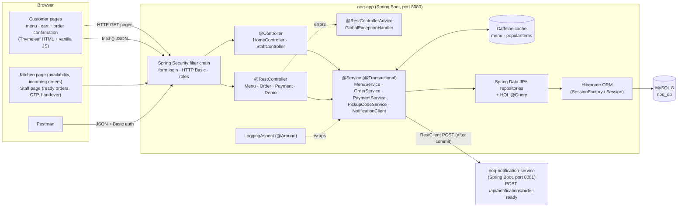
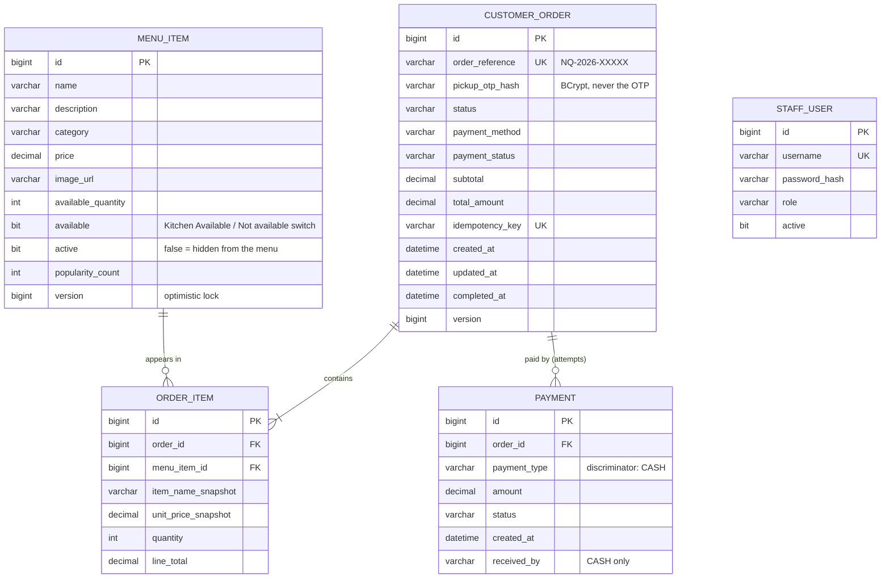
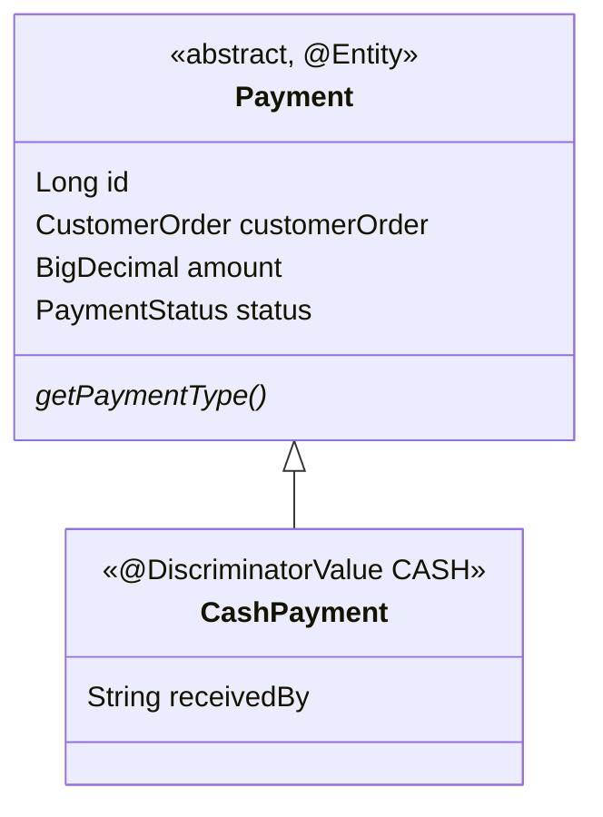
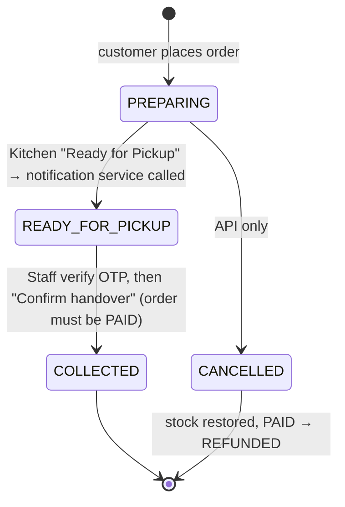
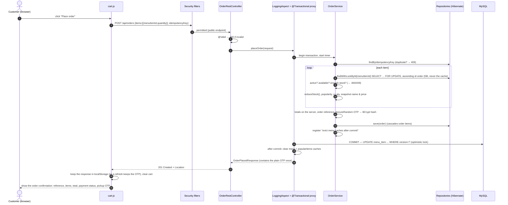
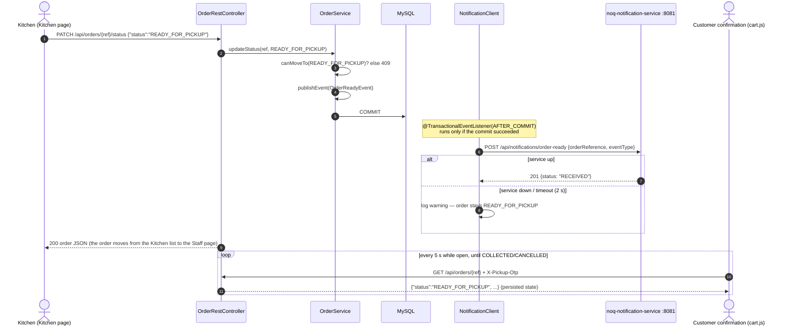
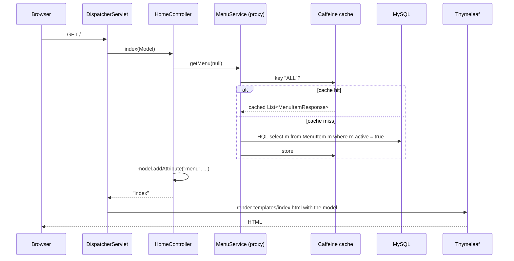

# NoQ — Architecture

Static PNG versions of the main diagrams (runtime architecture, request flow, workflows, order life-cycle, ER diagram, payment inheritance, notification sequence) are in [`diagrams/`](diagrams/). They are the same figures used in the project report.

## 1. System overview



**Monolith + one microservice.** The customer site, the Kitchen and Staff pages and the REST API are one deployable
Spring Boot application (a *modular monolith*). Notification sending is split out into a separate service with
its own process, port and build, talking to the main app only through HTTP/JSON.

## 2. Directory structure

```
noq-app/src/main/java/com/noq
├── NoqApplication.java              @SpringBootApplication + @EnableCaching
├── aspect/LoggingAspect.java        AOP: timing + failure logging for every service method
├── controller/                      MVC page controllers (return template names)
│   ├── HomeController.java          /  /cart
│   └── StaffController.java         /staff/login  /staff  /staff/kitchen
├── restcontroller/                  JSON API
│   ├── MenuRestController.java      /api/menu/**
│   ├── OrderRestController.java     /api/orders/**
│   ├── PaymentRestController.java   /api/orders/{ref}/payments/**
│   └── DemoRestController.java      /api/demo/** (viva demos)
├── service/
│   ├── MenuService.java             menu reads, Kitchen availability switch, @Cacheable, cache eviction after commit
│   ├── OrderService.java            checkout, status transitions, cancel (API), OTP check and handover
│   ├── PaymentService.java          counter payments (CashPayment)
│   ├── PickupCodeService.java       SecureRandom OTP, BCrypt hash, attempt limiter
│   ├── OrderReadyEvent.java         event published when an order becomes READY_FOR_PICKUP
│   ├── NotificationClient.java      RestClient call to the microservice (after commit)
│   └── ConceptDemoService.java      SessionFactory/Session/Transaction + IoC container demo
├── repository/                      Spring Data JPA interfaces (2 HQL queries)
├── entity/                          MenuItem, CustomerOrder, OrderItem, Payment(+CashPayment), StaffUser
├── dto/                             validated request/response records
├── enums/                           Category, OrderStatus, PaymentMethod, PaymentStatus, StaffRole
├── exception/                       ApiException, ApiError, GlobalExceptionHandler
└── security/                        SecurityConfig, StaffUserDetailsService

noq-app/src/main/resources
├── application.properties           MySQL, JPA, cache, actuator, NoQ settings
├── application-h2.properties        optional in-memory profile (also used by tests)
├── data.sql                         sample menu + staff (INSERT IGNORE)
├── templates/                       index, cart, error, fragments, staff/*
└── static/                          css/app.css, js/{app,menu,cart,staff,kitchen}.js, images/

noq-notification-service/src/main/java/com/noq/notification
├── NotificationServiceApplication.java
└── NotificationController.java      POST /api/notifications/order-ready, GET /api/notifications
```

## 3. Entity–relationship diagram



### Payment inheritance (SINGLE_TABLE)



Rows live in **one** `payment` table; Hibernate writes `payment_type = 'CASH'` and uses that column to decide which
Java class to instantiate when reading. Another way of paying would be one more subclass with its own discriminator value.

## 4. Order status life-cycle



The Kitchen page lists PREPARING orders; the Staff page lists READY_FOR_PICKUP orders.
Payment status is separate: `PENDING → PAID` (recorded at the counter when staff verify a correct OTP), and `PAID → REFUNDED` when a paid
order is cancelled.

## 5. Request flow — placing an order



## 6. Request flow — order becomes READY_FOR_PICKUP (microservice integration)



## 7. Request flow — a Thymeleaf page (MVC)



## 8. Security map

| Path | Who |
|---|---|
| `/`, `/cart`, static files, `/actuator/health` | everyone |
| `GET /api/menu/**` | everyone |
| `POST /api/orders` | everyone |
| `GET /api/orders/{ref}` | everyone, but the **service** checks the `X-Pickup-Otp` header (or staff login) |
| `/staff/kitchen`, `PATCH /api/menu/{id}/availability`, `PATCH /api/orders/{ref}/status` | KITCHEN |
| `GET /api/orders` | KITCHEN or STAFF |
| `POST .../verify-pickup`, `POST .../collect`, `POST .../payments/counter-confirmation`, `/api/demo/**`, `/actuator/**` | STAFF |
| `/staff` | KITCHEN or STAFF (redirects the kitchen to `/staff/kitchen`) |

Unauthenticated API calls get **401** JSON, wrong role gets **403** JSON; browser pages redirect to `/staff/login`.
