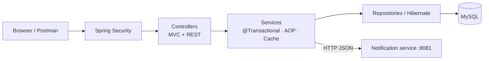

# NoQ — Smart Canteen Pre-Ordering and Queue Management System

**Mini-project report · IT23502 Web Programming (Unit IV: Advanced Frameworks, Unit V: Web Services)**

Team: `<Student 1 — Reg. No.>`, `<Student 2 — Reg. No.>`, `<Student 3 — Reg. No.>`
Guide: `<Faculty name>` · Department of Information Technology · `<College>` · `<Month Year>`

---

## Abstract

College canteens get long queues at peak hours: students wait to order, wait to pay and wait again to collect.
**NoQ** ("No Queue") is a web application that lets students browse the live canteen menu on any device, pre-order,
collect and pay at the counter, and receive an order reference plus a secret six-digit pickup
OTP on an order-confirmation screen. The kitchen marks orders ready and switches dishes Available / Not available; counter staff verify the pickup code, which completes the pickup, and hand the food over (payment is taken by hand and is not part of the application). The open confirmation screen shows the order's current status. The system is built with Java 21, Spring Boot 3.5 (Spring MVC, Spring Data
JPA with Hibernate, Spring Security, Spring Cache with Caffeine, Spring AOP), Thymeleaf, vanilla JavaScript and MySQL 8,
exposes a REST API tested with Postman, and integrates with a separate Spring Boot notification microservice
over HTTP. 32 automated tests and a 35-request Postman collection verify the behaviour.

## 1. Introduction

### 1.1 Problem statement
At peak times the canteen counter is a bottleneck. Students lose break time, staff juggle verbal orders, items sell out
while people are queuing, and there is no record of what sells best.

### 1.2 Objectives
1. Let customers browse the live menu, filter/search it and order without creating an account.
2. Validate every order on the server: prices, availability — never trusting the browser.
3. Generate a unique order reference and a secure pickup OTP, shown on an order-confirmation screen.
4. Keep payment out of the application: it is taken by hand at the counter, so NoQ neither records nor checks it.
5. Give the kitchen one page (availability, incoming orders) and counter staff one page (pickup).
6. Demonstrate Unit IV concepts (Spring Boot, MVC, JPA/Hibernate, HQL, Session/Transaction, DI, AOP,
   caching) and Unit V concepts (REST web services, microservices).

### 1.3 Scope
In scope: one canteen, customer ordering, staff operations, one notification microservice.
Out of scope: any payment handling, customer accounts, SMS/e-mail delivery, multi-canteen support, cloud deployment.

## 2. Requirements

### 2.1 Functional
| ID | Requirement |
|---|---|
| F1 | Display menu with categories, images, prices, descriptions and availability (popular items through the API and the *Most popular* sort) |
| F2 | Filter by category, search, sort; add/update/remove cart items; see subtotal and total |
| F3 | Place order; server validates availability and prices transactionally |
| F4 | Show an order confirmation: unique order reference, items, total and pickup OTP |
| F5 | Pickup: staff enter the customer's OTP once; if the order is READY_FOR_PICKUP and the OTP is right it becomes COLLECTED (payment is taken by hand, outside NoQ) |
| F6 | Kitchen: PREPARING orders with one *Ready for Pickup* button; Staff: READY_FOR_PICKUP orders only - *Verify & Complete Pickup* (one call: status and OTP checked, COLLECTED) |
| F7 | Kitchen page: Menu Availability (one Available / Not available switch per dish, enforced at checkout) and Incoming Orders (auto-refreshing); the menu itself (items and prices) comes from `data.sql` |
| F8 | Notify a separate service when an order is READY_FOR_PICKUP |
| F9 | REST API for all of the above |

### 2.2 Non-functional
Security (role-based access, hashed passwords and OTPs, no secrets in Git), consistency (transactions, optimistic
locking, valid status transitions), performance (menu caching, batch fetching), usability (mobile-first UI, one action per
order card), maintainability (layered architecture, DTOs, centralised errors, tests).

### 2.3 Hardware / software
Any PC with 4 GB RAM · JDK 21 · MySQL 8 · Maven (wrapper included) · modern browser · Postman · STS/IntelliJ · Git.

## 3. System design

### 3.1 Architecture
Layered Spring MVC monolith plus one microservice — see the diagrams in [`ARCHITECTURE.md`](ARCHITECTURE.md):

- **Presentation:** Thymeleaf pages (`controller/`) and JSON endpoints (`restcontroller/`).
- **Business:** `@Service` classes with `@Transactional` methods.
- **Persistence:** Spring Data JPA repositories → Hibernate → MySQL.
- **Cross-cutting:** Spring Security, AOP logging, Caffeine cache, centralised exception handling.
- **Integration:** `NotificationClient` (RestClient) → `noq-notification-service` on port 8081.

### 3.2 Database design
Five tables in third normal form (full DDL in [`schema-mysql.sql`](schema-mysql.sql), ER diagram in `ARCHITECTURE.md §3`):

| Table | Key columns | Constraints |
|---|---|---|
| `menu_item` | id, name, category, price, available, active, popularity_count, version | PK, index on category |
| `customer_order` | id, order_reference, pickup_otp_hash, status, subtotal, total_amount, idempotency_key, timestamps, version | PK, UNIQUE(order_reference), UNIQUE(idempotency_key), index (status, created_at) |
| `order_item` | id, order_id, menu_item_id, item_name_snapshot, unit_price_snapshot, quantity, line_total | PK, FK → customer_order, FK → menu_item |
| `staff_user` | id, username, password_hash, role, active | PK, UNIQUE(username) |

Money uses `DECIMAL`/`BigDecimal`; timestamps use `DATETIME(6)`/`LocalDateTime`. Order items store a name/price
snapshot so menu changes never alter past bills.

### 3.3 Order state machine
`PREPARING → READY_FOR_PICKUP → COLLECTED`, with `CANCELLED` allowed (API only) while PREPARING (popularity is reversed). The kitchen sets READY_FOR_PICKUP; COLLECTED is reachable only through the staff's
one-step pickup (a single request that checks the order is ready and the OTP is right).

### 3.4 Modules
1. **Menu module** — browsing, caching, popularity, the Kitchen availability switch.
2. **Order module** — checkout, availability check, reference/OTP, status transitions, cancellation, pickup.
3. **Staff module** — login, KITCHEN/STAFF roles, Kitchen page, Staff page.
5. **Notification microservice** — receives "order ready" events.

## 4. Implementation

### 4.1 Technology stack
Java 21 · Spring Boot 3.5.16 · Spring MVC · Thymeleaf · Spring Data JPA · Hibernate 6.6 · MySQL 8 (H2 for tests) ·
Spring Security 6.5 · Spring Validation · Spring Cache + Caffeine · Spring AOP · Spring Boot Actuator · RestClient ·
JUnit 5 + MockMvc · HTML5/CSS3/vanilla JS · Maven 3.9 · Git.

### 4.2 Key implementation points
- **Server-side checkout** (`OrderService.placeOrder`): merges duplicate lines, reads each item from the database,
  checks active/available, increments popularity (one atomic UPDATE), snapshots name/price, computes totals,
  generates the reference and OTP, saves everything in one transaction.
- **Concurrency:** there is no stock, so customers ordering the same dish never get a conflict or a "sold out" (popularity is bumped by
  one atomic UPDATE); every order action (pay, status change, pickup) locks the order row first. `@Version` on
  `MenuItem` and `CustomerOrder` is the safety net; conflicts return HTTP 409.
- **Duplicate submissions:** a browser-generated `idempotencyKey` with a UNIQUE constraint.
- **Pickup OTP:** `SecureRandom`, stored as a BCrypt hash, returned once, never logged, 5-attempt limit on the customer's
  order read-back (counted atomically before the BCrypt check).
- **Status rules** in one method (`OrderStatus.canMoveTo`).
- **Caching:** `@Cacheable` menu and popular-item lists; cleared after the transaction commits for staff edits and orders; 60-second TTL.
- **Notifications:** `OrderReadyEvent` + `@TransactionalEventListener(AFTER_COMMIT)` → `RestClient` POST with 2-second
  timeouts; failures logged without affecting the order.
- **Security:** form login (pages), HTTP Basic (API clients), JSON 401/403, BCrypt passwords, KITCHEN vs STAFF roles.
- **UI:** mobile-first CSS (warm off-white palette, charcoal text, green for success), menu filter/search/sort, cart in `localStorage`,
  order confirmation kept on the device (so a refresh keeps the pickup code) that re-reads its status every 5 s,
  10-second refresh of the Kitchen and Staff lists, emoji
  fallback for missing images.

### 4.3 Unit IV concept demonstrations

| Concept | Implementation |
|---|---|
| Spring Boot & MVC | `NoqApplication`; `HomeController` → `MenuService` → `MenuItemRepository` → `index.html` |
| JPA / Hibernate ORM | Entities in `entity/`, repositories in `repository/`, CRUD in `MenuService` |
| HQL (2+) | Popular items (`MenuItemRepository.findPopularAvailable`), orders by status (`CustomerOrderRepository.findByStatusNewestFirst`), plus two more in `ConceptDemoService` |
| Inheritance mapping | Not demonstrated in the current version (the former `Payment` → `CashPayment` hierarchy was removed with payment tracking) |
| SessionFactory / Session / Transaction | `ConceptDemoService.hibernateSessionDemo()` → `GET /api/demo/hibernate-session` |
| DI, BeanFactory, ApplicationContext | Constructor injection everywhere; `GET /api/demo/spring-container` |
| AOP | `LoggingAspect` `@Around` on all service methods |
| Caching | `MenuService` with Caffeine; hits visible at `/actuator/metrics/cache.gets` |

### 4.4 Unit V concept demonstrations

| Concept | Implementation |
|---|---|
| REST API | 13 endpoints under `/api` using GET, POST and PATCH ([`API.md`](API.md)); PUT and DELETE are explained as concepts only |
| Status codes | 200, 201, 204, 400, 401, 403, 404, 409, 503 |
| Validation & errors | `@Valid` DTOs, `GlobalExceptionHandler`, uniform `ApiError` JSON |
| JSON | Jackson serialisation of DTO records |
| Microservice | `noq-notification-service` on port 8081, called via `RestClient` |

## 5. Web services — theory

A **web service** is a software component that other programs call over a network through standard protocols
(HTTP) and data formats (JSON, XML), independent of programming language or platform.

**REST** is an architectural style in which resources are identified by URLs and manipulated through a uniform set of
HTTP methods (GET read, POST create, PUT replace, PATCH partial update, DELETE remove), exchanging representations such
as JSON. Interactions are stateless; responses carry status codes (2xx success, 4xx client error, 5xx server error) and
may be cached.

**JSON** (JavaScript Object Notation) is a lightweight text format of objects, arrays, strings, numbers, booleans and null;
it is easy for humans to read and for every language to parse, which makes it the de-facto format for REST APIs.

**SOAP** is a protocol that wraps every message in an XML envelope, describes operations in a WSDL contract, can run over
several transports, and includes WS-* standards for security and transactions.

| Aspect | REST | SOAP |
|---|---|---|
| Nature | Architectural style | Protocol |
| Format | JSON (or XML, text…) | XML only |
| Contract | Optional (OpenAPI) | Required (WSDL) |
| Transport | HTTP | HTTP, SMTP, JMS |
| Performance | Lightweight, cacheable | Verbose, more processing |
| Security | HTTPS + tokens/OAuth | WS-Security built in |
| Typical use | Web & mobile apps, public APIs, microservices | Banking, payment networks, legacy enterprise systems |

NoQ uses REST because its clients are browser JavaScript and Postman and it needs no WS-* features.

## 6. Monolith vs microservices; Spring Cloud

A **monolith** is a single deployable application containing all features (the `noq-app` module): simple to develop,
test, deploy and debug; one database; in-process calls. Drawbacks appear at scale: the whole app must be redeployed
for any change, and one part can't be scaled alone.

**Microservices** split the system into small independently deployable services that communicate over the network
(`noq-notification-service`). Benefits: independent deployment and scaling, fault isolation, technology freedom.
Costs: network failures, distributed data, monitoring and deployment complexity.

NoQ keeps the core as a monolith — the right choice for a small team — and extracts one loosely coupled concern to
demonstrate service-to-service REST communication. Because the call is synchronous, a slow or offline notification
service could delay or lose notifications; NoQ limits the damage with a 2-second timeout, calling only after the database
commit, and logging failures. A message broker (RabbitMQ, Kafka) would make delivery reliable.

**Spring Cloud** provides building blocks for larger microservice systems: service discovery (Eureka, Consul),
centralised configuration (Config Server), API gateway (Spring Cloud Gateway), client-side load balancing, circuit
breakers (Resilience4j), distributed tracing and messaging abstractions (Spring Cloud Stream). They are not needed for
two services on known ports, so NoQ does not use them.

## 7. Testing

### 7.1 Automated tests (`./mvnw test` — 32 tests, all passing on the H2 profile)
| Suite | Tests |
|---|---|
| `OrderStatusTest` (unit) | valid transitions; invalid transitions incl. completed → preparing |
| `MenuApiTest` (MockMvc, H2) | public menu hides inactive items and internal fields; category filter + bad category 400; unavailable item; HQL popular ordering; real BCrypt logins for `kitchen` and `staff` (each only its own role; the old admin login is rejected); the Kitchen availability switch (saved, enforced at checkout, 403/401 for other callers); cache fill + eviction (only after commit, not on rollback) |
| `OrderApiTest` (MockMvc, H2) | order creation with server-side totals and popularity; 7 invalid-order cases (400/409); duplicate submission; full order lifecycle incl. invalid transitions, wrong OTP, double pickup, unknown order, removed two-step endpoints, parallel pickups collect once, staff.js calls only `/pickup`; only counter payment exists; cancellation reverses popularity; customer reads own order only with the OTP and never sees it; staff page is one list; OTP lock-out on the customer read; tracking/payment pages removed; staff authorization; repeated orders and a 6-thread race for the same item (all succeed); cancel-vs-ready race; repeated cancellation; 20 parallel OTP guesses; Hibernate/Spring demo endpoints |
| `NotificationControllerTest` | valid event → 201; invalid payload → 400 |

### 7.2 Manual / Postman tests
The Postman collection (31 requests with assertions) covers every endpoint and the main failure cases. The main
workflow (ordering, confirmation, staff confirm/ready, notification delivery,
wrong and correct OTP, cancellation, availability toggle) was also exercised against the running application.

### 7.3 Sample test cases
| # | Input | Expected | Result |
|---|---|---|---|
| 1 | Order 2 × Samosa + 1 × Chai, counter | 201, total ₹55, OTP 6 digits | Pass |
| 2 | Order Garden Salad Bowl (marked not available) | 409 "is not available right now" | Pass |
| 3 | Order quantity 0 | 400 with field error | Pass |
| 4 | Ready for Pickup pressed twice / COLLECTED via status change | 409 / 400 | Pass |
| 5 | Pickup of an order that is still PREPARING | 409 "not ready for pickup" | Pass |
| 6 | Verify with wrong OTP | 400 | Pass |
| 7 | Verify twice | 409 "already collected" | Pass |
| 8 | `staff` toggles availability / `kitchen` collects an order | 403 / 403 | Pass |
| 9 | 6 simultaneous orders for the same item | 6 × 201 (no stock limit) | Pass |
| 10 | Notification service down, Ready for Pickup | 200, order READY_FOR_PICKUP, warning logged | Pass |
| 11 | 20 parallel wrong OTP guesses | at most 5 checked, then locked | Pass |

## 8. Results

*(Real screenshots of the final application are in [`screenshots/`](screenshots/); the full list is in [`REQUIREMENTS_MAP.md`](REQUIREMENTS_MAP.md), and the same images are used in the Word report. Postman, console and test-run screenshots still need to be captured by the team.)*

- Figure 1 — Customer menu (`01-customer-menu.png`)
- Figure 2 — Cart and checkout (`04-cart-checkout.png`)
- Figure 3 — Order confirmation with the pickup OTP (`05-order-confirmation-otp.png`)
- Figure 4 — Kitchen page, Incoming Orders (`06-kitchen-incoming-orders.png`)
- Figure 5 — Kitchen page, Menu Availability (`07-kitchen-menu-availability.png`)
- Figure 6 — Staff page: ready orders with the OTP field (`09-staff-ready-orders-otp.png`)
- Figure 7 — Staff page: OTP field and Verify & Complete Pickup (`10-staff-otp-verified.png`)
- Figure 8 — The customer's confirmation after the handover (`12-order-collected-customer.png`)
- Figure 9 — Postman responses (201, 400, 401, 403, 409) *(to be captured)*
- Figure 10 — Both services running; notification log line *(to be captured)*
- Figure 11 — `./mvnw clean package` BUILD SUCCESS *(to be captured)*

## 9. Limitations and future enhancements

| Limitation | Possible enhancement |
|---|---|
| No payment handling (taken by hand at the counter) | Record payments in the application, or add an online gateway such as Razorpay/Stripe confirmed via webhook |
| Status updates by polling (confirmation every 5 s, Kitchen and Staff lists every 10 s) | Server-Sent Events or WebSockets; real SMS / push notifications |
| Notification only logged | SMS / e-mail / web push; message broker with retries |
| OTP attempt counter in memory | Persist in the database or Redis for multi-server deployments |
| No customer accounts | Optional login with order history and favourites |
| Pre-orders are accepted at any time | Scheduled pre-order slots and kitchen capacity limits |
| `ddl-auto=update` never alters existing columns | Flyway migrations, `ddl-auto=validate` |
| Single canteen | Multi-outlet support, analytics dashboard |

## 10. Conclusion

NoQ meets its objectives: customers can pre-order from a responsive interface and collect with a secure pickup code,
the kitchen and the counter staff each work from one clear page, and orders stay consistent under concurrent use. The
project demonstrates the complete Spring stack required by Unit IV — MVC, dependency injection, JPA/Hibernate with HQL,
inheritance mapping, sessions and transactions, AOP and caching — and the Unit V concepts of RESTful web services and
microservice communication, with automated tests and Postman collections proving the behaviour.

## References

1. Spring Boot Reference Documentation, https://docs.spring.io/spring-boot/
2. Spring Framework Reference (Core, Web MVC, Data Access, AOP), https://docs.spring.io/spring-framework/reference/
3. Spring Data JPA Reference, https://docs.spring.io/spring-data/jpa/reference/
4. Hibernate ORM User Guide, https://docs.jboss.org/hibernate/orm/6.6/userguide/html_single/Hibernate_User_Guide.html
5. Spring Security Reference, https://docs.spring.io/spring-security/reference/
6. Thymeleaf + Spring tutorial, https://www.thymeleaf.org/doc/tutorials/3.1/thymeleafspring.html
7. Caffeine cache, https://github.com/ben-manes/caffeine
8. R. T. Fielding, *Architectural Styles and the Design of Network-based Software Architectures*, PhD thesis, UC Irvine, 2000.
9. MDN Web Docs — HTTP response status codes, https://developer.mozilla.org/en-US/docs/Web/HTTP/Status
10. Spring Cloud project overview, https://spring.io/projects/spring-cloud
