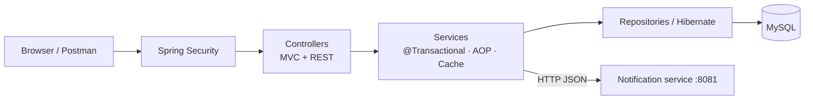

# NoQ — Smart Canteen Pre-Ordering and Queue Management System

**Mini-project report · IT23502 Web Programming (Unit IV: Advanced Frameworks, Unit V: Web Services)**

Team: `<Student 1 — Reg. No.>`, `<Student 2 — Reg. No.>`, `<Student 3 — Reg. No.>`
Guide: `<Faculty name>` · Department of Information Technology · `<College>` · `<Month Year>`

---

## Abstract

College canteens get long queues at peak hours: students wait to order, wait to pay and wait again to collect.
**NoQ** ("No Queue") is a web application that lets students browse the live canteen menu on any device, pre-order,
choose pay-at-counter or a simulated online payment, and receive an order reference plus a secret six-digit pickup
OTP. Canteen staff use a separate dashboard to accept orders, track preparation, record counter payments, verify
pickup codes and manage the menu and stock. The system is built with Java 21, Spring Boot 3.5 (Spring MVC, Spring Data
JPA with Hibernate, Spring Security, Spring Cache with Caffeine, Spring AOP), Thymeleaf, vanilla JavaScript and MySQL 8,
exposes a versioned REST API tested with Postman, and integrates with a separate Spring Boot notification microservice
over HTTP. 32 automated tests and a 47-request Postman collection verify the behaviour, on JDK 21 and MySQL 8.4.

## 1. Introduction

### 1.1 Problem statement
At peak times the canteen counter is a bottleneck. Students lose break time, staff juggle verbal orders, items sell out
while people are queuing, and there is no record of what sells best.

### 1.2 Objectives
1. Let customers browse the live menu, filter/search it and order without creating an account.
2. Validate every order on the server: stock, prices, availability — never trusting the browser.
3. Generate a unique order reference and a secure pickup OTP; allow tracking with live status.
4. Support counter payment and a clearly labelled simulated online payment, kept separate from food status.
5. Give staff a fast dashboard for order processing, payments, pickup verification and menu management.
6. Demonstrate Unit IV concepts (Spring Boot, MVC, JPA/Hibernate, HQL, inheritance mapping, Session/Transaction, DI, AOP,
   caching) and Unit V concepts (REST web services, microservices).

### 1.3 Scope
In scope: one canteen, customer ordering, staff operations, simulated payments, one notification microservice.
Out of scope: real payment gateways, customer accounts, SMS/e-mail delivery, multi-canteen support, cloud deployment.

## 2. Requirements

### 2.1 Functional
| ID | Requirement |
|---|---|
| F1 | Display menu with categories, images, prices, descriptions, availability; popular items |
| F2 | Filter by category, search, sort; add/update/remove cart items; see subtotal and total |
| F3 | Place order with payment method; server validates and deducts stock transactionally |
| F4 | Return unique order reference and pickup OTP; track status with automatic refresh |
| F5 | Pay at counter (staff confirms) or simulated online payment (success/failure) |
| F6 | Staff: view/filter orders, confirm, prepare, ready, cancel, mark paid, verify OTP to complete |
| F7 | Admin: add/edit items, update stock, mark sold out, deactivate/reactivate |
| F8 | Notify a separate service when an order is READY |
| F9 | REST API for all of the above |

### 2.2 Non-functional
Security (role-based access, hashed passwords and OTPs, no secrets in Git), consistency (transactions, optimistic
locking, valid status transitions), performance (menu caching, batch fetching), usability (mobile-first UI, live
status), maintainability (layered architecture, DTOs, centralised errors, tests).

### 2.3 Hardware / software
Any PC with 4 GB RAM · JDK 21 · MySQL 8 · Maven (wrapper included) · modern browser · Postman · STS/IntelliJ · Git.

## 3. System design

### 3.1 Architecture
Layered Spring MVC monolith plus one microservice — see the diagrams in [`ARCHITECTURE.md`](ARCHITECTURE.md):

- **Presentation:** Thymeleaf pages (`controller/`) and JSON endpoints (`restcontroller/`).
- **Business:** `@Service` classes with `@Transactional` methods.
- **Persistence:** Spring Data JPA repositories → Hibernate → MySQL.
- **Cross-cutting:** Spring Security, AOP logging, Caffeine cache, centralised exception handling.
- **Integration:** `NotificationClient` (RestClient) → `noq-notification-service` on port 8081.

### 3.2 Database design
Five tables in third normal form (full DDL in [`schema-mysql.sql`](schema-mysql.sql), ER diagram in `ARCHITECTURE.md §3`):

| Table | Key columns | Constraints |
|---|---|---|
| `menu_item` | id, name, category, price, available_quantity, available, active, popularity_count, version | PK, index on category |
| `customer_order` | id, order_reference, pickup_otp_hash, status, payment_method, payment_status, subtotal, total_amount, idempotency_key, timestamps, version | PK, UNIQUE(order_reference), UNIQUE(idempotency_key), index (status, created_at) |
| `order_item` | id, order_id, menu_item_id, item_name_snapshot, unit_price_snapshot, quantity, line_total | PK, FK → customer_order, FK → menu_item |
| `payment` | id, order_id, payment_type (discriminator), amount, status, received_by, transaction_reference, gateway | PK, FK → customer_order |
| `staff_user` | id, username, password_hash, role, active | PK, UNIQUE(username) |

Money uses `DECIMAL`/`BigDecimal`; timestamps use `DATETIME(6)`/`LocalDateTime`. Order items store a name/price
snapshot so menu changes never alter past bills.

### 3.3 Order state machine
`PLACED → CONFIRMED → PREPARING → READY → COMPLETED`, with `CANCELLED` allowed only from PLACED or CONFIRMED (stock is
restored; a paid order becomes REFUNDED). COMPLETED is reachable only through OTP verification of a PAID order.
Online orders must be PAID before CONFIRMED; counter orders may be prepared before payment (configurable with
`noq.orders.require-payment-before-confirm`).

### 3.4 Modules
1. **Menu module** — browsing, caching, popularity, staff management.
2. **Order module** — checkout, stock control, reference/OTP, status transitions, cancellation, pickup.
3. **Payment module** — counter payment, simulated gateway, inheritance-mapped payment records.
4. **Staff module** — login, roles, order board, menu forms.
5. **Notification microservice** — receives "order ready" events.

## 4. Implementation

### 4.1 Technology stack
Java 21 · Spring Boot 3.5.16 · Spring MVC · Thymeleaf · Spring Data JPA · Hibernate 6.6 · MySQL 8 (H2 for tests) ·
Spring Security 6.5 · Spring Validation · Spring Cache + Caffeine · Spring AOP · Spring Boot Actuator · RestClient ·
JUnit 5 + MockMvc · HTML5/CSS3/vanilla JS · Maven 3.9 · Git.

### 4.2 Key implementation points
- **Server-side checkout** (`OrderService.placeOrder`): merges duplicate lines, reads each item from the database,
  checks active/available/stock, deducts stock and increments popularity, snapshots name/price, computes totals,
  generates the reference and OTP, saves everything in one transaction.
- **Concurrency:** `@Version` optimistic locking on `MenuItem` and `CustomerOrder`; conflicts return HTTP 409.
- **Duplicate submissions:** a browser-generated `idempotencyKey` with a UNIQUE constraint.
- **Pickup OTP:** `SecureRandom`, stored as a BCrypt hash, returned once, never logged, 5-attempt limit on public lookups
  (counted atomically before the BCrypt check).
- **Abandoned online orders:** a `@Scheduled` job cancels unpaid ONLINE orders after 15 minutes (configurable) and returns
  their stock; late payments are refused.
- **Status rules** in one method (`OrderStatus.canMoveTo`).
- **Payments:** `CashPayment` and `OnlinePayment` subclasses of abstract `Payment` (SINGLE_TABLE). `PaymentGateway`
  interface with `MockPaymentGateway`.
- **Caching:** `@Cacheable` menu and popular-item lists; cleared after the transaction commits for staff edits and orders; 60-second TTL.
- **Notifications:** `OrderReadyEvent` + `@TransactionalEventListener(AFTER_COMMIT)` → `RestClient` POST with 2-second
  timeouts; failures logged without affecting the order.
- **Security:** form login (pages), HTTP Basic (API clients), JSON 401/403, BCrypt passwords, ADMIN vs STAFF roles.
- **UI:** mobile-first CSS (warm neutral palette, saffron accent), menu filter/search/sort, cart in `localStorage`,
  5-second status polling with progress indicator, 10-second staff board refresh, emoji fallback for missing images.

### 4.3 Unit IV concept demonstrations

| Concept | Implementation |
|---|---|
| Spring Boot & MVC | `NoqApplication`; `HomeController` → `MenuService` → `MenuItemRepository` → `index.html` |
| JPA / Hibernate ORM | Entities in `entity/`, repositories in `repository/`, CRUD in `MenuService` |
| HQL (2+) | Popular items (`MenuItemRepository.findPopularAvailable`), orders by status (`CustomerOrderRepository.findByStatusNewestFirst`), plus `type(p)` grouping in `ConceptDemoService` |
| Inheritance mapping | `Payment` → `CashPayment` / `OnlinePayment`, `@DiscriminatorColumn(payment_type)` |
| SessionFactory / Session / Transaction | `ConceptDemoService.hibernateSessionDemo()` → `GET /api/demo/hibernate-session` |
| DI, BeanFactory, ApplicationContext | Constructor injection everywhere; `GET /api/demo/spring-container` |
| AOP | `LoggingAspect` `@Around` on all service methods |
| Caching | `MenuService` with Caffeine; hits visible at `/actuator/metrics/cache.gets` |

### 4.4 Unit V concept demonstrations

| Concept | Implementation |
|---|---|
| REST API | 18 endpoints under `/api` with GET, POST, PUT, PATCH, DELETE ([`API.md`](API.md)) |
| Status codes | 200, 201, 204, 400, 401, 403, 404, 409, 503 |
| Validation & errors | `@Valid` DTOs, `GlobalExceptionHandler`, uniform `ApiError` JSON |
| JSON | Jackson serialisation of DTO records |
| Microservice | `noq-notification-service` on port 8081, called via `RestClient` |

## 5. Web services — theory

A **web service** is a software component that other programs call over a network through standard protocols
(HTTP) and data formats (JSON, XML), independent of programming language or platform.

**REST** is an architectural style in which resources are identified by URLs and manipulated through a uniform set of
HTTP methods (GET read, POST create, PUT replace, PATCH partial update, DELETE remove), exchanging representations such
as JSON. Interactions are stateless; responses carry status codes (2xx success, 4xx client error, 5xx server error) and
may be cached.

**JSON** (JavaScript Object Notation) is a lightweight text format of objects, arrays, strings, numbers, booleans and null;
it is easy for humans to read and for every language to parse, which makes it the de-facto format for REST APIs.

**SOAP** is a protocol that wraps every message in an XML envelope, describes operations in a WSDL contract, can run over
several transports, and includes WS-* standards for security and transactions.

| Aspect | REST | SOAP |
|---|---|---|
| Nature | Architectural style | Protocol |
| Format | JSON (or XML, text…) | XML only |
| Contract | Optional (OpenAPI) | Required (WSDL) |
| Transport | HTTP | HTTP, SMTP, JMS |
| Performance | Lightweight, cacheable | Verbose, more processing |
| Security | HTTPS + tokens/OAuth | WS-Security built in |
| Typical use | Web & mobile apps, public APIs, microservices | Banking, payment networks, legacy enterprise systems |

NoQ uses REST because its clients are browser JavaScript and Postman and it needs no WS-* features.

## 6. Monolith vs microservices; Spring Cloud

A **monolith** is a single deployable application containing all features (the `noq-app` module): simple to develop,
test, deploy and debug; one database; in-process calls. Drawbacks appear at scale: the whole app must be redeployed
for any change, and one part can't be scaled alone.

**Microservices** split the system into small independently deployable services that communicate over the network
(`noq-notification-service`). Benefits: independent deployment and scaling, fault isolation, technology freedom.
Costs: network failures, distributed data, monitoring and deployment complexity.

NoQ keeps the core as a monolith — the right choice for a small team — and extracts one loosely coupled concern to
demonstrate service-to-service REST communication. Because the call is synchronous, a slow or offline notification
service could delay or lose notifications; NoQ limits the damage with a 2-second timeout, calling only after the database
commit, and logging failures. A message broker (RabbitMQ, Kafka) would make delivery reliable.

**Spring Cloud** provides building blocks for larger microservice systems: service discovery (Eureka, Consul),
centralised configuration (Config Server), API gateway (Spring Cloud Gateway), client-side load balancing, circuit
breakers (Resilience4j), distributed tracing and messaging abstractions (Spring Cloud Stream). They are not needed for
two services on known ports, so NoQ does not use them.

## 7. Testing

### 7.1 Automated tests (`./mvnw test` — 32 tests, all passing on JDK 21 and 26)
| Suite | Tests |
|---|---|
| `OrderStatusTest` (unit) | valid transitions; invalid transitions incl. completed → preparing |
| `MenuApiTest` (MockMvc, H2) | public menu hides inactive items and internal fields; category filter + bad category 400; sold-out item; HQL popular ordering; 401/403/201 with real BCrypt login; validation errors; cache fill + eviction (only after commit, not on rollback); soft delete |
| `OrderApiTest` (MockMvc, H2) | order creation with server-side totals, stock and popularity; 9 invalid-order cases (400/409); duplicate submission; full counter lifecycle incl. invalid transitions, payment-before-pickup, duplicate payment, wrong OTP, double pickup; online mock fail/success/duplicate; cancellation restores stock; OTP required and never exposed; OTP lock-out; staff authorization; 6-thread race for the last item; unpaid-online-order expiry, late payment, payment-vs-expiry race, double "Mark paid", double-click payment, cancel-vs-payment race; repeated cancellation; 20 parallel OTP guesses; Hibernate/Spring demo endpoints |
| `NotificationControllerTest` | valid event → 201; invalid payload → 400 |

### 7.2 Manual / Postman tests
The Postman collection (47 requests with assertions) covers every endpoint and the main failure cases; all pass
against a fresh H2 database and a fresh MySQL 8.4.9 database. The UI flow was tested end-to-end in the browser: ordering, failed then successful demo
payment, staff confirm/prepare/ready, notification delivery, wrong and correct OTP, menu management.

### 7.3 Sample test cases
| # | Input | Expected | Result |
|---|---|---|---|
| 1 | Order 2 × Samosa + 1 × Chai, counter | 201, total ₹55, OTP 6 digits, stock −2/−1 | Pass |
| 2 | Order Margherita Pizza (stock 0) | 409 "is sold out" | Pass |
| 3 | Order quantity 0 | 400 with field error | Pass |
| 4 | PLACED → READY | 409 invalid transition | Pass |
| 5 | Verify pickup before payment | 409 "Payment pending" | Pass |
| 6 | Verify with wrong OTP | 400 | Pass |
| 7 | Verify twice | 409 "already collected" | Pass |
| 8 | Online order confirm before paying | 409 | Pass |
| 9 | `kitchen` user creates menu item | 403 | Pass |
| 10 | 6 simultaneous orders for last item | 1 × 201, 5 × 409, stock 0 | Pass |
| 11 | Notification service down, mark READY | 200, order READY, warning logged | Pass |
| 12 | Online order left unpaid past the window | cancelled automatically, stock restored, late payment 409 | Pass (also on MySQL 8.4.9) |
| 13 | 20 parallel wrong OTP guesses | at most 5 checked, then locked | Pass |

## 8. Results

*(Real screenshots are in [`screenshots/`](screenshots/), listed in [`REQUIREMENTS_MAP.md`](REQUIREMENTS_MAP.md). Postman, console and test-run screenshots still need to be captured by the team.)*

- Figure 1 — Customer menu with live status and popular items (`01-customer-menu-desktop.png`)
- Figure 2 — Cart and payment selection (`03-cart-desktop.png`)
- Figure 3 — Simulated payment screen (`04-demo-online-payment.png`)
- Figure 4 — Order tracking with progress bar and pickup code (`05-tracking-placed-with-pickup-code.png`)
- Figure 5 — "Your order is ready!" (`06-tracking-ready.png`)
- Figure 6 — Staff order board (`11-staff-order-board.png`)
- Figure 7 — Menu management (`13-admin-menu-management.png`)
- Figure 8 — Postman responses (201, 400, 401, 403, 409)
- Figure 9 — Both services running; notification log line
- Figure 10 — `./mvnw test` BUILD SUCCESS

## 9. Limitations and future enhancements

| Limitation | Possible enhancement |
|---|---|
| Online payment is simulated | Integrate Razorpay/Stripe test mode behind `PaymentGateway`, confirm via webhook |
| Status updates by 5-second polling | Server-Sent Events or WebSockets |
| Notification only logged | SMS / e-mail / web push; message broker with retries |
| OTP attempt counter in memory | Persist in the database or Redis for multi-server deployments |
| No customer accounts | Optional login with order history and favourites |
| Opening hours shown but not enforced | Scheduled pre-order slots and kitchen capacity limits |
| `ddl-auto=update` never alters existing columns | Flyway migrations, `ddl-auto=validate` |
| Single canteen | Multi-outlet support, analytics dashboard |

## 10. Conclusion

NoQ meets its objectives: customers can pre-order from a responsive interface and collect with a secure pickup code,
staff process orders and payments from a clear dashboard, and stock stays consistent under concurrent orders. The
project demonstrates the complete Spring stack required by Unit IV — MVC, dependency injection, JPA/Hibernate with HQL,
inheritance mapping, sessions and transactions, AOP and caching — and the Unit V concepts of RESTful web services and
microservice communication, with automated tests and Postman collections proving the behaviour.

## References

1. Spring Boot Reference Documentation, https://docs.spring.io/spring-boot/
2. Spring Framework Reference (Core, Web MVC, Data Access, AOP), https://docs.spring.io/spring-framework/reference/
3. Spring Data JPA Reference, https://docs.spring.io/spring-data/jpa/reference/
4. Hibernate ORM User Guide, https://docs.jboss.org/hibernate/orm/6.6/userguide/html_single/Hibernate_User_Guide.html
5. Spring Security Reference, https://docs.spring.io/spring-security/reference/
6. Thymeleaf + Spring tutorial, https://www.thymeleaf.org/doc/tutorials/3.1/thymeleafspring.html
7. Caffeine cache, https://github.com/ben-manes/caffeine
8. R. T. Fielding, *Architectural Styles and the Design of Network-based Software Architectures*, PhD thesis, UC Irvine, 2000.
9. MDN Web Docs — HTTP response status codes, https://developer.mozilla.org/en-US/docs/Web/HTTP/Status
10. Spring Cloud project overview, https://spring.io/projects/spring-cloud
